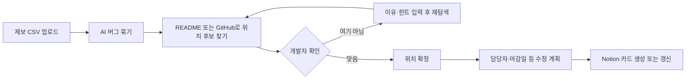

# 🐞📍 BugPin

> 쏟아지는 게임 버그 제보를 AI가 묶고, 고칠 코드 위치와 수정 일정까지 한 번에 정리해 주는 QA 도구

**시연 사이트:** <https://nd07tv61glm3psch.jitda.io/>  
**샘플 게임 저장소:** <https://github.com/ksw-0409/Slime_Hunt>

AI 부트캠프 팀 **영삼이**의 프로젝트입니다. 짓다(jitda) 플랫폼의 바이브 코딩 환경과 짓다 제공 LLM `jitda-chat`으로 만들었습니다.

## 왜 만들었나요

게임을 테스트하면 같은 버그를 여러 사람이 조금씩 다른 말로 제보하곤 합니다. QA 담당자는 제보를 하나씩 비교해 묶고, 개발자는 증상을 단서로 코드를 살펴 원인을 찾아야 합니다. 정리된 결과를 일정 도구에 다시 옮기는 일도 남습니다.

BugPin은 반복적인 제보 정리를 AI가 돕고, 사람은 후보를 검토하고 확정하는 과정을 한 화면으로 연결합니다.

## 주요 기능

| 기능 | 설명 |
|---|---|
| 제보 CSV 업로드 | 파일을 올리거나 샘플 20건을 불러옵니다. UTF-8·엑셀 CP949, 쉼표와 줄바꿈이 들어간 제보를 처리합니다. |
| AI 버그 묶기 | 비슷한 증상의 제보를 버그로 묶고, 버그가 아닌 의견과 확인이 필요한 제보를 분리합니다. |
| 제보 원문 확인 | 버그 카드에서 대표 제보와 전체 원문을 확인합니다. 상단 버그 요약을 누르면 해당 카드가 열립니다. |
| README 기반 후보 찾기 | 프로젝트 설명에 나온 스크립트를 바탕으로 의심 파일·함수와 이유를 추정합니다. README만으로 실제 코드 줄을 확인하지는 않습니다. |
| GitHub 실제 코드 분석 | 연결된 저장소의 C# 코드를 읽어 후보와 코드 근거를 보여 줍니다. 코드 인용이 원본과 일치할 때만 줄 번호를 표시합니다. 저장소는 읽기 전용으로 접근합니다. |
| 개발자 피드백 재탐색 | 후보가 맞지 않으면 이유나 힌트를 남겨 다른 위치를 다시 찾습니다. 이미 제외한 후보는 다음 탐색에서 피합니다. |
| 후보 선택·확정 | 후보를 신뢰도 순으로 살펴보고 하나 또는 여러 위치를 확정합니다. |
| 수정 계획 | 담당자·마감일·우선순위·메모를 입력합니다. Notion DB를 설정하면 카드를 생성하거나 기존 카드를 갱신합니다. |
| Notion README 불러오기 | 설정된 Notion 페이지의 Markdown 본문을 README 입력으로 불러옵니다. |

## 이용 흐름



## 시연 순서

1. `샘플 20건 불러오기`를 누르고 `분석 시작`을 선택합니다.
2. 버그 카드의 제보 원문을 비교합니다.
3. `프로젝트 정보`에서 GitHub 저장소 탭을 열고 [Slime_Hunt 샘플 저장소](https://github.com/ksw-0409/Slime_Hunt)를 입력합니다. README만 확인하려면 샘플 README를 사용할 수 있습니다.
4. 의심 위치를 분석하고 후보를 선택합니다. 후보가 맞지 않으면 `여기 아님 · 다른 곳 찾기`로 다시 탐색합니다.
5. 선택한 후보를 확정한 뒤 담당자와 마감일을 입력하고 계획을 저장합니다. Notion이 연결되어 있으면 생성·갱신된 카드 링크가 표시됩니다.

헤더의 `처음부터 다시` 버튼이나 새로고침으로 언제든 시연을 빈 상태에서 다시 시작할 수 있습니다. 이 동작은 이미 만들어진 Notion 카드를 삭제하거나 수정하지 않습니다.

## 기술 구성

| 구분 | 기술 |
|---|---|
| 개발 환경 | 짓다(jitda) 플랫폼 바이브 코딩 |
| 서버 | Node.js 내장 `node:http` — 외부 npm 런타임 패키지 없이 실행 |
| 화면 | HTML · CSS · 브라우저 JavaScript |
| AI | 짓다 제공 `jitda-chat` — Chat Completions 호환 API |
| 외부 연동 | GitHub REST API(읽기 전용), Notion API(README 읽기·수정 계획 카드 쓰기) |
| 테스트 | Node.js 내장 `node:test`, 브라우저 E2E 테스트 |

## 빠른 시작

### 필요한 환경

- Node.js 22.9 이상 권장
- npm
- 별도 npm 패키지 설치 없이 실행할 수 있습니다.

### 실행

```sh
git clone https://github.com/ksw-0409/jitda-project.git
cd jitda-project
cp .env.example .env
# .env에 사용할 서버 환경 변수를 설정합니다.
npm run dev
```

브라우저에서 <http://localhost:3000>을 엽니다. 개발 모드는 파일 변경을 반영합니다. 일반 실행은 `npm start`를 사용합니다. `PORT`를 지정하지 않으면 3000번 포트를 사용하며, 서버는 `0.0.0.0`에서 요청을 받습니다.

## 환경 변수

실제 값은 `.env` 또는 서버 환경 변수에만 설정하고, `.env` 파일을 저장소에 올리지 마세요.

| 변수 | 필요한 기능 | 설명 |
|---|---|---|
| `LLM_API_KEY` | 실제 AI 분석 | 짓다 LLM API 키입니다. 서버에서만 사용합니다. |
| `LLM_BASE_URL` | 실제 AI 분석 | 짓다 Chat Completions 호환 API 주소입니다. 모델은 `jitda-chat`을 사용합니다. |
| `GITHUB_TOKEN` | 선택 | 비공개 저장소 접근 또는 GitHub API 한도 확대용입니다. 공개 저장소는 없어도 됩니다. 필요한 읽기 권한만 부여하세요. |
| `NOTION_TOKEN` | Notion 기능 | Notion internal integration 토큰입니다. 브라우저로 보내지 않습니다. |
| `NOTION_PAGE_ID` | Notion README 불러오기 | README 본문을 읽을 Notion 페이지 ID입니다. |
| `NOTION_PLAN_DATABASE_ID` | Notion 수정 계획 등록 | 수정 계획을 저장할 DB ID 또는 Notion DB 링크입니다. |
| `PORT` | 선택 | 서버 포트입니다. 기본값은 `3000`입니다. |

`.env.example`에는 변수 이름만 있습니다. `OPENAI_API_KEY`는 사용하지 않습니다.

## Notion 설정

### README 페이지 연결

1. [Notion integrations](https://www.notion.so/my-integrations)에서 internal integration을 만들고 콘텐츠 읽기 권한을 설정합니다.
2. README가 있는 Notion 페이지의 공유 메뉴에서 해당 integration을 초대합니다.
3. 서버 환경 변수에 `NOTION_TOKEN`과 `NOTION_PAGE_ID`를 설정하고 서버를 다시 시작합니다.
4. 화면의 `노션 README 불러오기`를 누릅니다. 페이지 제목만이 아니라 Markdown 본문을 가져옵니다.

### 수정 계획 DB 연결

Notion DB에 다음 속성 이름과 형식을 사용합니다. 서버는 시작할 때 DB의 data source와 스키마를 확인하며, 이름·형식이 맞지 않으면 카드를 만들지 않고 오류를 알려 줍니다.

| 속성 | Notion 형식 | 값 또는 선택지 |
|---|---|---|
| `버그` | 제목(title) | 우선순위 표시와 버그 제목 |
| `담당자` | 텍스트(rich text) | 담당자 이름 |
| `마감일`, `등록일` | 날짜(date) | 날짜 |
| `우선순위`, `상태` | 선택(select) | 우선순위: `높음`, `보통`, `낮음`; 상태: `계획됨`, `보류`, `완료` |
| `위치`, `파일`, `함수`, `줄`, `메모`, `버그 ID` | 텍스트(rich text) | 수정 위치와 계획 정보 |

`NOTION_PLAN_DATABASE_ID`를 설정하고 같은 integration을 DB에 공유해야 합니다. 카드 본문에는 원인 추정, 근거 코드, 연결된 제보 원문이 들어갑니다. 계획 저장이 실패해도 입력한 계획은 새로고침 전까지 현재 탭에 남으며, 다시 시도할 수 있습니다.

BugPin에는 로그인이 없습니다. 연결한 Notion 페이지나 DB를 읽고 쓸 수 있는 사용자를 제한하고, integration은 필요한 리소스에만 공유하세요.

## 입력 형식

### 제보 CSV

다음 열이 필요하며 `report_id`는 각 제보마다 고유해야 합니다.

```csv
report_id,reporter,created_at,text
R001,tester01,2026-11-20 14:02,슬라임을 잡았는데 회색으로 변하고 사라지지 않아요
R002,tester02,2026-11-20 14:10,대각선으로 가면 캐릭터가 더 빨라져요
R003,tester03,2026-11-20 14:15,"쉼표, 줄바꿈이 있는 제보는 큰따옴표로 감쌉니다.
다음 줄도 같은 제보의 원문입니다."
```

### 프로젝트 README (`.md`)

스크립트 경로 또는 파일명과 역할을 적습니다. README 분석은 설명을 바탕으로 후보를 추정하므로 실제 코드 인용이나 줄 번호를 만들지 않습니다.

```markdown
## 스크립트 구성
- `PlayerMovement.cs` — 입력 방향에 따라 플레이어를 이동합니다.
- `MonsterHealth.cs` — 몬스터 체력과 사망 상태를 관리합니다.
```

## 데모 자료

| 파일 | 용도 |
|---|---|
| `sample_reports.csv` | 화면의 샘플 불러오기에 쓰이는 QA 제보 20건 |
| `sample_README.md` | 기능 설명이 담긴 데모 README |

샘플 CSV에서 실제 LLM 호출이 인증 또는 연결 문제로 실패하면 화면 흐름 확인을 위한 임시 예시 결과가 나올 수 있습니다. 이 경우 화면에 실제 AI 분석 결과가 아니라는 안내가 표시됩니다.

## API

모든 API는 같은 출처에서 호출합니다. 분석·GitHub·Notion 계획 등록은 JSON `POST` 요청이고, Notion README는 `GET` 요청입니다.

| 경로 | 역할 | 주요 입력 |
|---|---|---|
| `POST /api/analyze` | 제보를 버그·의견·확인 필요로 분류 | `reports` |
| `POST /api/locate` | README에서 의심 위치 후보 찾기 | `bugs`, `readme` |
| `POST /api/locate-again` | 개발자 피드백으로 다른 후보 재탐색 | `bug`, `reports`, `feedback`, `excluded`, 탐색 차수, README 또는 GitHub 연결 ID |
| `POST /api/github/connect` | GitHub 저장소 연결 및 C# 파일 목록 조회 | `repoUrl` |
| `POST /api/github/file` | 연결된 저장소의 C# 파일 읽기 | `connectionId`, `path` |
| `POST /api/github/analyze-code` | 실제 GitHub 코드에서 의심 위치 분석 | `connectionId`, `bugs` |
| `GET /api/notion/readme` | 설정된 Notion 페이지의 Markdown 본문 가져오기 | 서버 환경 변수 `NOTION_TOKEN`, `NOTION_PAGE_ID` |
| `POST /api/notion/plan` | 수정 계획 카드 생성 또는 기존 카드 갱신 | `plan`, `cause_hypothesis`, `code_candidates`, `reports`, 선택적 `notion_page_id` |

새로고침 후 `notion_page_id`가 없으면 서버가 Notion DB의 `버그 ID` 속성으로 카드를 찾습니다. 휴지통에 있는 페이지는 건너뛰며, 저장된 페이지 ID가 404이거나 페이지가 휴지통에 있으면 새 카드를 생성합니다.

## 시연 데이터와 상태

- 수정 계획, 확정 위치, 제외 후보, 담당자 자동완성, Notion 페이지 ID는 브라우저 탭의 메모리에만 유지합니다. `localStorage`, `sessionStorage`, 서버 파일에 저장하지 않습니다.
- 새로고침하면 업로드, 분석 결과, 후보, 계획, Notion 페이지 참조가 초기화됩니다. 시작 시 이전 버전의 계획·담당자·Notion 링크 저장 키도 삭제합니다.
- `처음부터 다시` 버튼은 확인 창 없이 현재 세션을 초기화하고 페이지 맨 위로 이동합니다. Notion에 이미 생성된 카드는 삭제하거나 수정하지 않습니다.
- 수정 계획 JSON은 사용자가 직접 내보내기를 눌렀을 때만 다운로드합니다.
- Notion 카드는 외부 서비스에 저장되므로 앱 세션을 초기화해도 남습니다. 새 세션에서 같은 버그 ID를 저장하면 기존 활성 카드를 갱신합니다.
- GitHub 연결 정보는 코드 분석 요청을 위해 서버 메모리에 임시 보관되며, 수정 계획이나 브라우저 세션 상태를 파일/DB에 저장하지 않습니다.

## 프로젝트 구조

```text
.
├── index.html                 # 업로드, 분석, 후보, 수정 계획 화면
├── server.js                  # API 서버, LLM·GitHub·Notion 연동
├── analysis-view-model.js     # CSV 파싱과 화면용 분석 결과 정리
├── fix-plan-model.js          # 수정 계획 검증과 마감일 계산
├── sample_reports.csv         # 데모 QA 제보 20건
├── sample_README.md           # 데모 프로젝트 설명
└── test/
    ├── unit/                  # 단위 테스트
    ├── integration/           # API와 Notion 동작 테스트
    ├── e2e/                   # 브라우저 전체 흐름 테스트
    └── helpers/               # 가짜 LLM·Notion 및 테스트 서버
```

## 보안과 한계

- API 키와 Notion 토큰은 서버에서만 사용하며 화면이나 응답에 노출하지 않습니다.
- GitHub는 읽기 전용입니다. 코드 수정·커밋·브랜치 작업을 하지 않습니다.
- README 후보는 문서 설명을 기반으로 한 추정이며 실제 코드 근거나 줄 번호가 아닙니다.
- GitHub 코드 분석은 C# 파일 중심의 제한된 탐색이지, 저장소 전체를 증명하는 정적 분석은 아닙니다. 최종 판단과 수정 책임은 개발자에게 있습니다.
- BugPin에는 계정이나 사용자 간 동기화가 없습니다. 현재 탭을 닫거나 새로고침하면 진행 중인 세션 데이터는 사라집니다.

## 테스트

Node.js 내장 `node:test`를 사용합니다. 단위·통합 테스트는 패키지 설치 없이 실행할 수 있습니다. 브라우저 E2E에는 개발 환경의 `agent-browser`가 필요합니다.

```sh
npm run test:unit          # 단위 테스트
npm run test:integration   # 가짜 LLM·Notion을 사용하는 API 통합 테스트
npm run test:e2e           # 브라우저 E2E
npm test                   # 전체 테스트
```

현재 테스트는 CSV 불러오기, 버그 묶기, README·GitHub 후보, 피드백 재탐색, 후보 선택, 계획 저장, 새로고침 초기화와 Notion 카드 생성·갱신·휴지통 복구 흐름을 확인합니다. 테스트용 응답은 앱 동작 검증용이며 실제 AI 분류 정확도 측정은 아닙니다.

## 팀 영삼이

강승우 · 김규태 · 이준하 · 심승민
